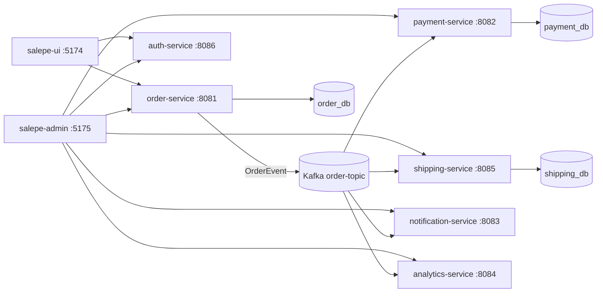

# Salepe

Salepe is an event-driven order-management platform built from Spring Boot microservices that communicate over Kafka, with two React front-ends: a customer storefront and an admin console.

## Contents

- [Architecture](#architecture)
- [Services](#services)
- [Data model](#data-model)
- [Event flow](#event-flow)
- [API reference](#api-reference)
- [Authentication](#authentication)
- [Front-ends](#front-ends)
- [Run locally](#run-locally)
- [Configuration](#configuration)
- [Troubleshooting](#troubleshooting)
- [Project layout](#project-layout)

## Architecture



There is no API gateway: the front-ends call each service directly (base URLs live in `src/api/config.ts` of each UI). CORS is configured in every service (`CorsConfig`).

## Services

| Component | Port | Database | Role |
|---|---|---|---|
| `order-service` | 8081 | `order_db` | Products and orders; **producer** of `order-topic` (idempotent, `acks=all`) |
| `payment-service` | 8082 | `payment_db` | Consumes order events, records payments |
| `notification-service` | 8083 | none | Consumes order events, sends notifications |
| `analytics-service` | 8084 | none (in-memory) | Consumes order events, aggregates summary stats |
| `shipping-service` | 8085 | `shipping_db` | Consumes order events, creates/tracks shipments |
| `auth-service` | 8086 | none (in-memory) | Phone-number OTP login and sessions |
| `salepe-ui` | 5174 | – | Customer storefront |
| `salepe-admin` | 5175 (Vite default 5173; falls forward if busy) | – | Admin console |

Tech: Java 21, Spring Boot 4.1.0, Spring Data JPA, Spring Kafka, Lombok, Actuator, PostgreSQL 16, Kafka 3.8 (KRaft); React 19, TypeScript, Vite, React Router 7, Axios.

Each consumer service uses its own consumer group (`<service-name>`, `auto-offset-reset: earliest`), so every service receives every order event.

## Data model

- **Order**: `id` (UUID), `customerId`, `status`, `totalAmount`, `items`, `createdAt`
- **OrderItem**: `productId`, `productName`, `quantity`, `price`
- **OrderStatus**: `CREATED`, `PAYMENT_PENDING`, `PAID`, `SHIPPED`, `DELIVERED`, `CANCELLED`
- **Product**: `name`, `description`, `price`, `imageUrl`, `stock`
- **PaymentStatus**: `SUCCESS`, `FAILED`
- **ShipmentStatus**: `PENDING`, `IN_TRANSIT`, `DELIVERED`

Schemas are managed by Hibernate (`ddl-auto: update`).

## Event flow

1. A client `POST`s `/api/orders` to `order-service`, which persists the order and publishes an `OrderEvent` to Kafka topic `order-topic`.
2. Payment, shipping, notification and analytics each consume the event independently.

`OrderEvent` payload:

```json
{
  "orderId": "uuid",
  "customerId": "string",
  "status": "CREATED",
  "totalAmount": 99.99,
  "items": [{ "productId": "…", "productName": "…", "quantity": 1, "price": 99.99 }],
  "occurredAt": "2026-01-01T00:00:00Z"
}
```

## API reference

| Service | Method & path | Description |
|---|---|---|
| order | `POST /api/products` | Create product (`name`, `description`, `price` > 0, `imageUrl`, `stock` ≥ 0) |
| order | `GET /api/products`, `GET /api/products/{id}` | List / fetch products |
| order | `POST /api/orders` | Place order (`customerId`, `items[]` of `productId`, `productName`, `quantity` ≥ 1, `price` > 0) → `201` |
| order | `GET /api/orders[?customerId=]` | List orders, optionally per customer |
| order | `GET /api/orders/{id}` | Fetch order |
| payment | `GET /api/payments/order/{orderId}` | Payment for an order |
| shipping | `GET /api/shipments/order/{orderId}` | Shipment for an order |
| analytics | `GET /api/analytics/summary` | Aggregate order stats |
| auth | `POST /api/auth/otp/request` | Request OTP for a phone number |
| auth | `POST /api/auth/otp/verify` | Verify OTP, returns session |
| auth | `GET /api/auth/session` | Validate current session |
| auth | `POST /api/auth/logout` | End session |
| all | `GET /actuator/health`, `/actuator/info` | Health |

Example:

```sh
curl -X POST localhost:8081/api/orders -H 'Content-Type: application/json' \
  -d '{"customerId":"c1","items":[{"productId":"p1","productName":"Shirt","quantity":2,"price":19.99}]}'
```

## Authentication

Dev-mode OTP login: the OTP is generated and **returned to the caller instead of being sent by SMS** (see `OtpService`). OTPs are 6 digits, valid for 300 s, max 5 attempts; sessions last 24 h. OTP and session stores are in memory, so they reset when `auth-service` restarts. Do not use this setup in production.

## Front-ends

**salepe-ui** (customer): `/login`, `/` and `/shop` (browse products), `/cart`, `/orders`, `/orders/:id`.

**salepe-admin**: `/login`, `/` and `/orders` (list), `/orders/new`, `/orders/:id` (order with payment/shipping), `/products`, `/analytics`.

Scripts (both): `npm run dev`, `npm run build`, `npm run lint` (oxlint), `npm run preview`.

## Run locally

Prerequisites: JDK 21 (the Maven wrapper is included; newer JDKs may not work with this project's build), Node.js 22+, Docker.

1. Infrastructure — Kafka `9092`, Postgres `5433` (user/password `postgres`), Kafka UI `8080`:

   ```sh
   docker compose up -d
   ```

   `init-db.sql` creates `order_db`, `payment_db`, `shipping_db` on first start. Kafka UI is optional.

2. Backend services, each in its own terminal (or in the background):

   ```sh
   export JAVA_HOME=$(/usr/libexec/java_home -v 21)
   for s in order payment shipping notification analytics auth; do
     (cd $s-service && ./mvnw spring-boot:run) &
   done
   ```

3. Front-ends:

   ```sh
   cd salepe-ui && npm install && npm run dev      # http://localhost:5174
   cd salepe-admin && npm install && npm run dev   # http://localhost:5175
   ```

4. Verify:

   ```sh
   for p in 8081 8082 8083 8084 8085 8086; do curl -s localhost:$p/actuator/health; echo; done
   ```

Stop everything: kill the Maven/Vite processes, then `docker compose down` (add `-v` to wipe the `salepe_pgdata` volume).

## Configuration

Per-service settings are in `<service>/src/main/resources/application.yaml`: `server.port`, Kafka bootstrap (`localhost:9092`), datasource URL (`localhost:5433/<db>`), and for auth the `app.otp.*` / `app.session.*` values. Override with environment variables, e.g. `SERVER_PORT=8090` or `SPRING_DATASOURCE_URL=…`.

## Troubleshooting

- **Port already in use** (e.g. 8080, 8081, 8085): find the holder with `lsof -nP -iTCP:<port> -sTCP:LISTEN`, stop it or change the port (remember to update `src/api/config.ts` in the UIs).
- **Build errors on a very new JDK**: set `JAVA_HOME` to JDK 21.
- **Services can't reach Kafka/Postgres**: check `docker compose ps`; Postgres is exposed on host port `5433`, not 5432.
- **Reset data**: `docker compose down -v` then `up -d`.

## Project layout

```
salepe/
├── docker-compose.yml   # Kafka, Kafka UI, Postgres
├── init-db.sql          # Per-service databases
├── order-service/       # Products, orders, Kafka producer
├── payment-service/     # Payments
├── shipping-service/    # Shipments
├── notification-service/# Notifications
├── analytics-service/   # Order analytics
├── auth-service/        # OTP auth + sessions
├── salepe-ui/           # Customer web app
└── salepe-admin/        # Admin web app
```
